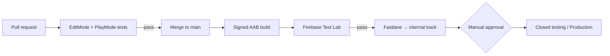

# One Room, Three Waves — RogueLike MVP

<!-- Activa este badge cuando exista .github/workflows/ci.yml (iteración 6) -->
<!--  -->


A small 2D roguelike for Android, built in Unity with C#. The game is intentionally tiny: the point of this repository is the **test automation, CI/CD pipeline and Google Play release workflow** around it.

> **Status:** in development — iteration 1 of 8 (project setup).

---

## The game

You are alone in one room. Survive three waves of enemies, pick one of three upgrades after each wave, and try to beat your high score. A full run takes 3–5 minutes.

- Touch joystick movement, automatic shooting at the nearest enemy
- 3 waves generated from a **seed**, so every run can be reproduced
- Upgrades between waves (damage, speed, health)
- Local high score and settings (volume, vibration)

## What this project demonstrates

| Area | Tools |
| --- | --- |
| Unit and integration tests | Unity Test Framework (EditMode, PlayMode), NUnit |
| End-to-end tests on device | AltTester, `adb` |
| Performance testing | Unity Profiler, FPS threshold tests |
| Device coverage | Firebase Test Lab (Game Loop) |
| CI/CD | GitHub Actions, GameCI, Fastlane |
| Release | Google Play internal, closed and production tracks |

## Architecture

Game rules live in plain C# classes with no dependency on `UnityEngine`, so they can be tested in milliseconds without loading a scene. MonoBehaviours only connect those classes to the engine.

```
Assets/
├── Scripts/
│   ├── Core/         Game.Core      → pure C#: WaveGenerator, CombatCalculator, UpgradeSystem, ScoreService
│   └── Unity/        Game.Unity     → MonoBehaviours, UI, input, persistence adapters
├── Tests/
│   ├── EditMode/     Tests.EditMode → fast unit tests for Game.Core
│   └── PlayMode/     Tests.PlayMode → scene and flow tests
├── Art/              (all rights reserved, see License)
└── Audio/            (all rights reserved, see License)
```

Design decisions that make the game testable:

- **Seeded randomness.** All randomness goes through an injectable seeded generator. Same seed, same waves.
- **Persistence behind an interface** (`ISaveStore`), replaced by an in-memory fake in tests.
- **Stable UI object names** (`PlayButton`, `UpgradeOption_0`, `HealthBar`) so AltTester can find them.
- **Debug mode only in test builds**, behind a custom scripting define (`SALA_DEBUG`): set the seed, win or lose a wave instantly.
- **AltTester is never included in release builds.**

## Test strategy

| Layer | What it checks | Runs |
| --- | --- | --- |
| EditMode | Wave generation, combat rules, upgrades, scoring | Every push (CI) |
| PlayMode | Scene loading, wave transitions, win and lose screens | Every push (CI) |
| End-to-end | Full run on a real phone: menu → 3 waves → victory | Physical device |
| Persistence | Settings and high score survive `adb shell am force-stop` | Physical device |
| Performance | Fails if FPS drops below 30 in wave 3 | Physical device |
| Compatibility | Game Loop on several device models | Firebase Test Lab, per release |

Some bugs are planted on purpose and documented in [`docs/seeded-bugs.md`](docs/seeded-bugs.md), together with the test that catches each one.

## CI/CD pipeline



## Getting started

**Requirements**

- Unity **6000.6.10f1** with Android Build Support (SDK, NDK, OpenJDK)
- [Git LFS](https://git-lfs.com)
- An Android phone with USB debugging enabled (optional, for device tests)

**Clone and open**

```bash
git lfs install
git clone https://github.com/maikreyes/RogueLike-MVP.git
```

Open the folder from Unity Hub.

**Run the tests**

- In the editor: *Window → General → Test Runner*
- From the command line:

```bash
<path-to-unity> -batchmode -projectPath . -runTests -testPlatform EditMode -testResults results-editmode.xml
```

**Install on a phone**

```bash
adb devices
adb install -r Builds/Android/RogueLike-MVP.apk
adb logcat -s Unity
```

**Unity YAML merge (recommended)**

```bash
git config merge.unityyamlmerge.driver '"<path-to-unity>/Tools/UnityYAMLMerge" merge -p %O %B %A %A'
```

## Roadmap

- [ ] Project setup, first test, empty build on device
- [ ] Movement, shooting and combat rules
- [ ] Seeded waves and upgrades
- [ ] Menus, high score, settings, debug mode → **Release 1: playable on device**
- [ ] AltTester end-to-end, persistence and performance tests
- [ ] GitHub Actions: tests on every PR, signed AAB on every merge → **Release 2: green pipeline**
- [ ] Fastlane, Firebase Test Lab, closed testing → **Release 3**
- [ ] Store listing and version 1.0 on Google Play → **Release 4**

## License

- **Source code** (`*.cs`, scripts, configuration, workflows): [MIT](LICENSE).
- **Art, audio, the name "One Room, Three Waves" and the app icon**: © 2026 Michael Estiven Reyes Escobar. All rights reserved. They may not be reused or redistributed, including in builds published to app stores.

The AltTester Unity SDK is used only in development and test builds and is not part of this repository or of release builds.